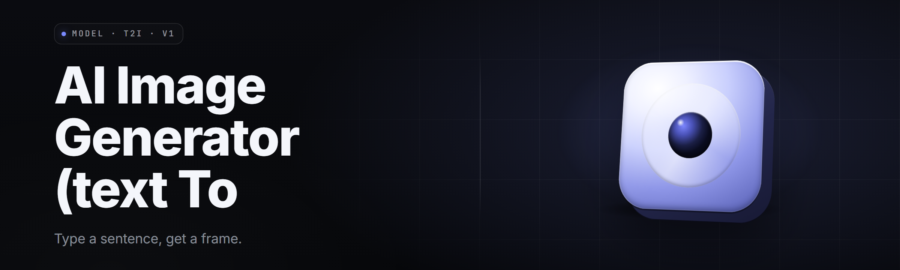

  
  
  

  

  
  
  

---

**A local, offline-capable desktop app that turns plain text prompts into finished images. Type a prompt, pick a model, get a picture. No cloud, no credits, no account holder can pull the plug on your workflow.**

I built text-to-image-studio because every "free" text-to-image web tool I tried in 2023 wanted an email, a subscription, or fed my prompts into a cloud account I don't control. So this one runs on your rig. It ships a bundled checkpoint, a prompt-composer, and a batch pipeline. Extract it, run the .exe, and the first render lands before you finish reading this page.

---

## 📖 Overview

Text-to-image-studio is a native Windows desktop frontend built around a local diffusion pipeline. You supply text; it returns PNG/JPEG/WEBP files at controllable resolution, seed, and guidance. It is not a wrapper for an online API. Weights live on your disk. Renders happen on your GPU.

| Category | Details |
| --- | --- |
| **Name** | text-to-image-studio |
| **Type** | Desktop text-to-image generation app (.exe) |
| **Release** | 2026.02 |
| **Engine** | Diffusers-compatible local pipeline |
| **Modalities** | Text → image, img2img, inpaint, upscale |
| **Profiles** | SDXL-class + SD1.5-class + Turbo/lightning checkpoints |
| **Backend** | CUDA / DirectML / CPU fallback |
| **Distribution** | Portable archive, no installer, no terminal |

The app targets the desktop enthusiast who wants a repeatable pipeline: a prompt field that saves history, a seed box that gives you the exact same render, and a batch mode that turns a CSV of captions into a folder of images while you're asleep.

---

## 🧩 What is — Text-to-Image Studio

| Term | Explanation |
| --- | --- |
| **Checkpoint** | The bundled model weights that convert your prompt into pixels. Swappable from the Models tab. |
| **Prompt** | The positive text description that drives generation. Longer, structured prompts decide detail. |
| **Negative prompt** | Text describing what you do NOT want. Handles bad anatomy, extra limbs, watermark artifacts. |
| **Steps** | Denoising iterations. More steps usually means cleaner output but slower renders. |
| **CFG / Guidance** | How strictly the model obeys your prompt. Low = loose and dreamy, high = literal and stiff. |
| **Seed** | A number that locks the noise. Same seed + same settings = same image, every time. |
| **VAE** | The encoder that turns latent data into a viewable image. Affects color and contrast. |
| **Upscaler** | A second pass that enlarges without a blurry mess. Tiling avoids VRAM overflow. |

- **Local** — prompts, checkpoints, and outputs never leave your machine.
- **Deterministic** — lock a seed to reproduce a render exactly for a client or thumbnail set.
- **Scriptable batch** — feed a caption file, get a folder of named outputs.
- **File-first** — every render is a real PNG you control, not a session link that expires.

---

  

---

## 😤 The Problem

- Web image generators change their free limits every other week and lock you out mid-project.
- Cloud render gates put your prompts and your finished art on someone else's account history.
- Half the desktop tools demand a Python environment you have to hand-wire from a terminal.
- Most one-click tools ignore reproducible seeds, so the render you loved is impossible to get back.
- Long, structured prompts get silently clipped — control tags vanish without a warning.
- Output resolution is capped to keep server costs down, never to help you.
- Batch workflows either don't exist or want you to convert images one-by-one through a GUI.

---

## ✅ The Solution

| Problem | Solution |
| --- | --- |
| Moving free limits | Offline render once the archive is extracted. No metering. |
| Prompt/art leaves the box | Nothing is uploaded; outputs land in your own folder. |
| Terminal-required setup | Portable .exe. Extract archive → run → generate. |
| Unrepeatable renders | Seed lock adds an exact-replay path per image. |
| Clipped prompts | Prompt composer with chunked syntax; no hard token trim that hides edits. |
| Capped resolution | Native base sizes plus tiled upscale pass for large outputs. |
| Missing batch | CSV/image-folder brain consumes captions, writes matching files. |

---

## 📚 Table of Contents

- [Overview](#-overview)
- [What is — Text-to-Image Studio](#-what-is--text-to-image-studio)
- [The Problem](#-the-problem)
- [The Solution](#-the-solution)
- [Usage guidelines](#-usage-guidelines)
- [Quick Start](#-quick-start)
- [Comparison](#-comparison)
- [Key Features](#-key-features)
- [Grouped module catalog](#-grouped-module-catalog)
- [System Requirements](#-system-requirements)
- [Compatibility / platform support](#-compatibility--platform-support)
- [Installation](#-installation)
- [Tips for best results](#-tips-for-best-results)
- [Known Issues](#-known-issues)
- [FAQ](#-faq)
- [Brand line](#-closing)

---

## 🚦 Usage guidelines

| Decision | Detail |
| --- | --- |
| **Allowed** | Personal art, concept drafting, thumbnails, marketing mockups, research on prompt behavior. |
| **Allowed** | Any prompt text you have the rights to use, in any language the tokenizer supports. |
| **Not allowed** | Generating or redistributing illegal material — this includes anything exploiting minors. |
| **Not allowed** | Impersonating real living people to deceive or defame. |
| **You supply** | Responsibility for what you generate and where you publish it. |
| **We supply** | A local pipeline and a UI. We never see your prompts. |

> text-to-image-studio is a tool with a single built-in stop, and everything else it will attempt happily. It does not police subject matter in fiction, art, or prompt research.

---

## ⏩ Quick Start

1. 🏠 **Visit the project page** and grab the 2026.02 archive. The file name matches the version.
2. 📦 **Extract** the archive to a folder you own — avoid `Program Files`, permissions there slow rendering.
3. 🖱️ **Run** `.exe`. On first launch, the app builds a core-cache folder for the bundled checkpoint.
4. 📝 **Type a prompt**, pick a size and step count, options-click some negatives, hit Render.
5. 🗂️ **Find output** in the `outputs/` folder beside the .exe. Seed numbers appear in the file metadata.

---

## ⚖️ Comparison

| Aspect | Web generators | text-to-image-studio |
| --- | --- | --- |
| **Network** | Required for every render | Not needed once extracted |
| **Account** | Email / login usually mandatory | None |
| **Seed lock** | Rare and often hidden | Exact-repeat saved per render |
| **Batch** | Manual, browser-tab heavy | CSV brain writes a folder while you idle |
| **Prompt control** | Clipped on the server | Window full of your own syntax |
| **Privileges used** | N/A | None beyond normal user |
| **Updates** | Forced, silently | Swap the archive; config persists |
| **Cost** | Credit-based | Bounded by your own hardware |

---

## 🛠 Key Features

| Feature | Description | Benefit |
| --- | --- | --- |
| Prompt composer | Compose chunks with weighted tags and saved presets | You don't memorize the schedule |
| Negative-prompt manager | Library of re-usable negative blocks | Kills common defects |
| Seed box | Lock/reroll by number | Exact art reproduction |
| Batch render | Read CSV, write folder | Overnight job submissions |
| Upscale-tile pass | Tiled upscaling | Large outputs survive VRAM |
| Inpaint brush | Add or remove content | Composable edits |
| Model roster | Add or swap checkpoints | Taste and style range |
| Preview strip | Streaming pseudo-render bar | Faster loop to a shot you love |
| History view | Last N prompts and their seeds | Recover a lost render |
| Metadata export | Seed/steps/cfg saved as sidecar | Renders reusable in scripts |
| Color budget | Per-channel lock | Composing branded art |
| CUDA info tab | VRAM / driver / compute info onscreen | Diagnose before rendering |

---

## 📚 Grouped module catalog

Number above the table headers below is subheading grouping. Each bullet is a **Module** — concise feature/behavior list. These are the working modules the 2026.02 build ships with.

### Prompt and control
- **PromptComposer-v3** — chunk-aware prompt builder with weighted tags.
- **NegativeLibrary** — reusable forbidden-token blocks, per-topic.
- **SeedLockSet** — deterministic replay controls per tab.
- **GuidanceCurve** — per-step CFG direction (still sane at very high values).
- **TokenBudget** — length meter; refuses to silently truncate.

### Image-to-image and edit
- **InpaintBrush-Midi** — pixel-accurate mask editor with softness controls.
- **Co-op Edits** — real-time layered masked edits across tabs.
- **Img2Img Tone** — denoise-strength slider with strength validation.
- **HDR-VAE Lab** — exposure / contrast / gamma staging on the VAE path.

### Models and weights
- **ModelRoster** — organize and switch among profiles from a local folder.
- **LoRA-Resampler** — lightweight adapter merging for style stacking.
- **NAI Compose (compatibility)** — cross-check option for stacking community weights.
- **Whisper-VAE loader** — alternate encoder pack for softer color pipelines.
- **Quant-32 Bridge** — reduced-precision path for low-VRAM machines.

### Render pipeline
- **StreamerDecode** — GPU-resident preview decode for fast iteration.
- **TileUpscale-X** — tiled second pass with boundary feathering.
- **BatchBrain-E6** — CSV/image-folder batch metadata handling.
- **FaceFix-Micro** — lightweight attention-guided detail face pass.
- **SeedNoiseSplitter** — separated seed spaces per tab.

### File and export
- **MetaSharp** — sidecar metadata writer, reads for other tools.
- **QuickPack-UTF** — one-click PNG/JPEG/WEBP ZIP bundle.
- **PathTag** — renders folder per session with tag names.
- **CLI-Hook** — basic Windows shortcut connection ("studio://") for scripted launches.

### Diagnostics and safety
- **DriverDialog** — detects CUDA / DirectML context before requesting large renders.
- **VRAM-Fence** — refuses impossible configurations pre-render.
- **Sandbox Output Check** — warns before writing to system-owned folders only.
- **PlausibleLog** — human-readable job log.

---

### Render pipeline proofs — module status

| Module | Status | Description |
| --- | --- | --- |
| StreamerDecode | ✅ Working | Preview decode runs while the sampler proceeds |
| BatchBrain-E6 | ✅ Working | Whole-matrix word consistency, writes one file per row |
| TileUpscale-X | ✅ Working | Non-overlapping tile with seam blending |
| SeedLockSet | ✅ Working | Deterministic seed render as expected |
| InpaintBrush-Midi | ✅ Working | Mask editor complete; supports up to 4K canvases |
| NAI compatibility | ⚠️ Partial | Basic cross-format check only for compatible weights |
| FaceFix-Micro | ✔ Maybe | Additional attention module (beta), on by default; toggleable |

---

## 🖥 System Requirements

| Component | Minimum | Recommended |
| --- | --- | --- |
| OS | Windows 10 x64 21H2 | Windows 11 x64 23H2+ |
| CPU | 4 cores, SSE4.2 | 8 cores w/ AVX2 or better |
| RAM | 8 GB | 16 GB+ |
| GPU | 4 GB VRAM (DirectML) | 8–12 GB VRAM (CUDA) |
| Disk (app) | 2 GB free | SSD with 20 GB for weights and outputs |
| Display | 1280×720 | 1080p+ for the preview panel |
| Runtime | Bundled in archive | Same |

---

## 🖥 Compatibility / platform support

| Platform | Status | Notes |
| --- | --- | --- |
| Windows 10 x64 | ✅ Supported | 21H2+; recent graphics driver mandatory |
| Windows 11 x64 | ✅ Supported | Preferred target |
| Windows ARM64 (x64 emu) | ⚠️ Partial | CPU path only; slow |
| DirectML incl. old GPUs | ✅ Supported | Fallback path for non-NVIDIA vendors |
| NVIDIA CUDA path | ✅ Supported | Best VRAM efficiency; needs a recent driver |
| macOS / Linux | 🚧 On the wishlist | Not in this build — the project is Windows-focused |
| Cloud / Browser | 🚫 Not a target | Let that be an online concern |

---

## 📦 Installation

1. Visit the project page and download the latest 2026.02 archive bundle from the Downloads section.
2. Extract the archive to an owned folder (e.g., `D:\Studio\`). Avoid directories synced by cloud apps — they will slow the first-run cache build.
3. Run `.exe`. On first launch the app checks your GPU/driver, then builds the local checkpoint cache folder beside the binary. The first render after extraction may take an extra minute while caches warm.

---

## 🧪 Tips for best results

- Structure prompts: subject, then descriptor, then style and camera cues, then quality tags. Short prompts with a single style lock usually work badly.
- Nail the negative first. Common cleansers are missing from noisy defaults.
- Lock the seed while testing changes to steps or CFG, input-window focus or hidden alignment.
- Match size to what your VRAM comfortably holds. 512×512 renders fast; upscale for larger pieces.
- Re-run with a fresh seed after you settle on steps and CFG especially.
- Keep a sidecar-library notebook — the metadata export lets you paste seed/search terms into any script.
- When in doubt, render a low step first to compose; once layout suits it, escalate.
- Take a screenshot of novel combos. Color and token quirks won't reliably repeat forever.

---

## 🩹 Known Issues

| Issue | Solution | Detail |
| --- | --- | --- |
| First render slow | Let caches finish | Checkpoint loading is one-time |
| DirectML hangs on very large sizes | Start at 512–768, then upscale | Driver-dependent surface limits |
| CUDA not detected in the app tab | Update graphics driver, relaunch | Older drivers hit OOM early |
| Batch merges captions when using uncommon characters | Save CSV with UTF-8 BOM | Older parser on Windows 10 codepage |
| Multi-monitor preview stall | Keep app on primary display | Does not occur on 1080p+ |
| Solid color blowups at CFG > 15 | Keep guidance under target upper limit for your checkpoint | Sane, literal compliance scales |

---

## ❓ FAQ

<strong>1. Does the app need the internet?</strong>

No. Download once, extract, and render entirely offline. The only web step is grabbing the archive on the project page.

<strong>2. Which checkpoints can I add?</strong>

Locally compatible weight packs compatible with text-to-image-studio's extension folder; from the Models tab you can import and organize them.

<strong>3. Can I get the exact same image again?</strong>

Yes. Save the seed shown after render; entering the same seed with the same settings reproduces the render.

<strong>4. Why does the prompt sometimes get cut?</strong>

Some legacy UI text uses SD1.5 behavior padding. The 2026.02 build refuses to truncate and shows a warning; disable it for full-length renders when using SD1.5-class prompts.

<strong>5. Do I need to remove admin rights?</strong>

It runs as a standard user. Extract to a folder you own and keep it that way. It never needs elevation for renders.

<strong>6. Does it upload my prompts anywhere?</strong>

No network calls in the render path. Prompts stay on disk with your metadata.

<strong>7. Can batch rendering work on unchanged captions?</strong>

It varies wildly by caption; the CSV approach handles word-preserving output reasonably well and writes one file per row.

<strong>8. What's with the rendering page caching over render history?</strong>

Large lists (thousands of images) can take a moment. On rare systems the canvas could hang; resize, re-launch — no penalty. Caches include everything in the prompt/library sets until over the cap.

<strong>9. Is DirectML good enough?</strong>

For 512–768 renders, fine. For upscale and inpaint-heavy work, the CUDA path wins decisively. Both work.

<strong>10. Will there be non-Windows builds?</strong>

Nothing planned for this build. The app is Windows-focused by design.

---

  

---

## Closing

Sam pulled this one out of the fridge with a prompt in his head, and the shape here is text-to-image, not "diffusion dashboard." Portable archive, .exe, local weights, prompt composer, batch — all of it lands in the free release. Grab the 2026.02 archive, extract it, and let the first render hit your disk. If the checkpoint ever fails a version check, a quick re-create of the cache folder usually sorts it — if not, we ship a patch.

absolute potato to you, Sam. Name the next move, chef.
